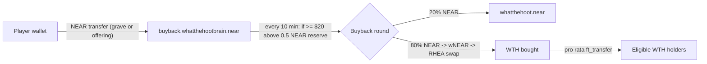
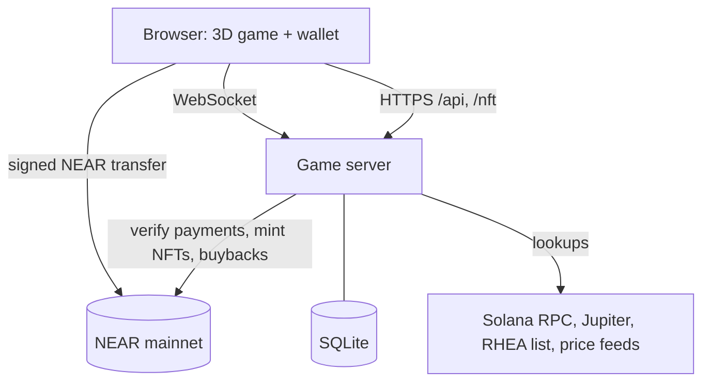

# REST IN PUMP

**A multiplayer 3D memorial world where memecoin communities gather, grow shared memorials together, and fund WTH buybacks through game activity.**

- Live: **https://rip.whatthehoot.lol**
- Demo video: https://x.com/what_the_hoot/status/2121557944718463103
- Repository: https://github.com/whatthehootwth-prog/rest-in-pump
- X: https://x.com/what_the_hoot
- Hackathon track: **Memecoins With Mechanics**
- Network: NEAR mainnet

Players walk a cartoon graveyard as owls, chat, and use silly emotes. Anyone can create a memorial (a grave) for a NEAR or Solana memecoin. Visitors leave paid offerings that give the memorial community EXP, and the grave evolves through four levels. Contributors receive a transferable NEAR NFT whose artwork follows the grave's level. The NEAR spent on graves and offerings is collected in a treasury account and periodically used to buy WTH on RHEA for eligible WTH holders.

The graveyard theme is playful satire. A memorial celebrates a memecoin's story and community; it is not a statement that the token is dead. Active and inactive memecoins are both welcome.

---

## Problem Statement

1. **Visibility fades with the hype.** When trading slows, many memecoin communities get quieter and their stories stop being told. There are few places built for coming back to a meme once the chart is no longer the attraction.
2. **Engagement is mostly trading.** Most meme platforms we looked at focus on launching and trading tokens. Shared experiences that do not depend on price action are rare.
3. **Fee-funded rewards depend on volume.** Holder rewards funded by trading fees shrink exactly when trading activity declines.

## Solution

REST IN PUMP gives memecoin communities a shared place and a shared goal that do not depend on trading:

- **Shared memorial spaces.** Each memecoin can have one memorial on one of 40 plots, with last words written by its creator.
- **Multiplayer social play.** Everyone is in the same live world: walking, chatting, dancing, crying and praying at graves.
- **Community progression.** Offerings add community EXP to a memorial. As EXP grows, the grave visibly evolves from a wooden cross to a mausoleum.
- **Dynamic Memorial NFTs.** Creators and contributors own an NFT for that memorial. Its artwork and attributes follow the grave, so it improves as the community keeps contributing.
- **Revenue-powered WTH buybacks.** The NEAR paid for graves and offerings funds WTH buybacks and eligible holder distributions, which is a source of holder rewards that comes from game activity rather than trading fees.

These pieces form one loop: a shared place gives people a reason to return, contributions grow a memorial everyone can see, contributors hold an NFT that reflects that growth, and the same spending feeds the WTH economy.

## Key Features

| Area | What is implemented |
|---|---|
| World | Cartoon 3D graveyard (three.js) with 40 memorial plots |
| Multiplayer | Real-time owls over WebSockets, server-validated movement, reconnect |
| Social | Chat with speech bubbles; dance, club, pray, cry, roll and hop |
| Memorials | NEAR and Solana memecoins; one memorial per token, forever |
| Discovery | Search by name or ticker (dead tokens included), or paste a contract / mint address |
| Offerings | Six priced offerings, each with fixed community EXP |
| Progression | Four levels: Forgotten, Remembered, Honored, Legendary |
| NFTs | Transferable NEP-171 Memorial NFTs with live artwork and attributes |
| Payments | NEAR Wallet Selector (MyNearWallet, Meteor, HERE); every payment verified on chain |
| Economy | Automated WTH buyback and holder distribution worker |
| Transparency | Public buyback settings and history (`/api/buybacks` and in-game explainer) |

## How It Works

1. **Enter the graveyard** at https://rip.whatthehoot.lol. No account or wallet is needed to walk around.
2. **Find a plot.** Walk onto an empty plot and press **E** to open "Dig a grave".
3. **Pick the memecoin.** Type its name or ticker, or paste a NEAR contract or Solana mint address. Solana memecoins are supported as memorial subjects only; payments and NFTs are on NEAR.
4. **Write its last words** (1 to 100 characters) and **connect a NEAR wallet** to pay. The wallet sends one plain NEAR transfer; the server confirms it on chain and the grave appears for everyone.
5. **Leave offerings.** At any grave, press **E** to leave a candle, flowers, instant noodles, a copium tank, a rug or diamond hands. Each adds community EXP.
6. **Watch the grave evolve.** Level 2 at 25 EXP, Level 3 at 250, Level 4 at 2,500.
7. **Receive a Memorial NFT.** The creator gets #001; every other wallet gets one with its first offering to that grave. One per wallet per grave.
8. **Revenue reaches WTH holders.** Payments collect in the treasury. When at least $20 is available, a round sends 20% to the team and uses 80% to buy WTH for eligible holders.

## Economic Model

| Item | Value |
|---|---|
| Grave | `GRAVE_PRICE_USD`, default **$1** in NEAR. The live deployment is currently set to **$0.10** (see `/api/config`) |
| Offerings | $0.10 to $10 in NEAR (fixed per item in `shared/graves.ts`) |
| Payment | Plain NEAR transfer to `buyback.whatthehootbrain.near`, verified by the server |
| Buyback check | Every 10 minutes |
| Threshold | $20 of NEAR available above a 0.5 NEAR reserve |
| Allocation | 20% NEAR to `whatthehoot.near` (team); 80% swapped to WTH on RHEA |
| Holder eligibility | At least 100,000 WTH; pools, exchanges, launchpad contracts and project wallets excluded |



There is no on-chain treasury contract: the split, the swap and the payouts are transactions signed by the game server with the treasury account's key, following the rules above. Rounds depend entirely on real game spending. Payouts, returns and token price effects are not guaranteed. Full details: [docs/ECONOMY.md](docs/ECONOMY.md).

## Why NEAR?

| What | How NEAR is used | Enforced by |
|---|---|---|
| Graves and offerings | Plain NEAR transfers from the player's wallet to the treasury | Wallet signature on chain; the server verifies the transaction (final, successful, signer, receiver, exact amount, time) |
| Memorial NFTs | NEP-171 contract with NEP-177 metadata, NEP-178 approvals, NEP-181 enumeration | Contract: minter-only minting, one memorial per wallet per grave, standard ownership and transfers |
| WTH buybacks | `wrap.near` (NEP-141) wrapping, swap on RHEA's DCL pool with a minimum output, WTH `ft_transfer` payouts | Token and DEX contracts execute; the server decides when and how much |
| Transparency | Every payment, mint, swap and payout is a public NEAR transaction | Public chain data |

Small payments matter here: offerings start at $0.10, and NEAR's low fees and fast finality make paying for a single candle practical. Named accounts (`memorial.whatthehootbrain.near`) make the deployed pieces easy to check. Community EXP, grave levels, pricing and buyback scheduling are kept by the game server, not by a contract (see [docs/CONTRACTS.md](docs/CONTRACTS.md)).

## Technical Architecture

| Layer | Technology |
|---|---|
| Frontend | TypeScript, Vite, three.js, Web Audio |
| Multiplayer | WebSockets (`ws`), server-authoritative state, 15 Hz snapshots |
| Backend | Node.js 24 running TypeScript directly |
| Database | SQLite (`node:sqlite`) on a persistent volume |
| NFT contract | Rust, near-sdk 5.29, NEP-171/177/178/181 |
| Wallets | NEAR Wallet Selector 10.1.4 |
| Token discovery | NEAR `ft_metadata` and RHEA token list; Solana RPC and Jupiter |
| Token execution | `wrap.near`, RHEA DCL (`dclv2.ref-labs.near`), WTH `ft_transfer` |
| Hosting | Railway (one service plus a `/data` volume) |



More: [docs/ARCHITECTURE.md](docs/ARCHITECTURE.md), [docs/CONTRACTS.md](docs/CONTRACTS.md).

## Security & Sustainability

- Payments are only fulfilled after on-chain verification; each transaction hash counts once, and each order has a unique exact amount.
- The minter account's server key can only call `mint_memorial`; the contract also allows only that account to mint, and only once per wallet per grave.
- Interrupted payments recover in the browser without a second payment; a background job re-checks them.
- Buyback steps are recorded before they are sent. An unknown transaction outcome stops all rounds until an operator checks it.
- The treasury key is a full-access key held by the server, so the server operator is trusted. Revenue depends on real activity; NFT storage and gas accounts need occasional top-ups; refunds are manual.

No formal audit has been done. Details and limitations: [docs/SECURITY.md](docs/SECURITY.md).

## How to Run & Test

Prerequisites: Node.js 22.18 or newer (24 recommended). Rust with the `wasm32-unknown-unknown` target only if you want to rebuild the contract.

```bash
npm install
npm run build        # client -> dist/client
npm start            # http://localhost:8787 (game, API and WebSocket)
npm run check        # typecheck client and server, then run the tests
```

Development with hot reload: `npm run dev:server` and `npm run dev:client` (Vite on :5173). A successful start logs the server listening on port 8787; opening it shows the intro screen, and **Enter the Meme Graveyard** puts you in the world. Locally, without keys, everything works except minting and buybacks, which stay off.

Configuration lives in environment variables; see [.env.example](.env.example). Never commit keys. Verification guide for judges: [docs/TESTING.md](docs/TESTING.md).

## Demo & Hackathon Scope

| Item | Value |
|---|---|
| Live game | https://rip.whatthehoot.lol |
| Demo video | https://x.com/what_the_hoot/status/2121557944718463103 |
| Repository | https://github.com/whatthehootwth-prog/rest-in-pump |
| Memorial NFT contract | [`memorial.whatthehootbrain.near`](https://nearblocks.io/address/memorial.whatthehootbrain.near) |
| Minter account | `minter.whatthehootbrain.near` (mint-only key) |
| Treasury / buyback account | [`buyback.whatthehootbrain.near`](https://nearblocks.io/address/buyback.whatthehootbrain.near) |
| Team wallet | `whatthehoot.near` |
| WTH token | `wth-0b2227.launchpad.justhoot.near` |
| Trailer source | Rendered from the game with the pipeline in [trailer/](trailer/README.md) |

**Verified on NEAR mainnet (14 Nov 2026):**
- Real grave payments to the treasury, for example [`EDphamgQ…SHxw`](https://nearblocks.io/txns/EDphamgQgat9AxcqZN5jq93X22ACmpQeZMZjMV53SxHw) and [`4Fi5Jd5Y…KcCz`](https://nearblocks.io/txns/4Fi5Jd5YjEHgNs3n7EHmR7Tevp4V1tZRQu8UQy12KcCz).
- Three live memorials ($NEKO, $BABYBLACKDRAGON, $LONK) and two offerings.
- Three Memorial NFTs minted (`nft_total_supply` = 3), with metadata served at `https://rip.whatthehoot.lol/nft/token/1-1.json`.

**Implemented but not yet executed on mainnet:** a buyback round. The worker is enabled and checking every 10 minutes, but the treasury had about $1.85 available against the $20 threshold, so no round has run (`/api/buybacks` shows zero rounds).

**What judges can test:** walk the live world, open any memorial, search for a memecoin in "Dig a grave", inspect the NFT contract and metadata, and read the buyback settings. Making a grave or an offering costs real NEAR (from $0.10). Grave progression to Legendary can be seen without spending, in the local demo graves or the trailer; see [docs/TESTING.md](docs/TESTING.md).

**Current limitations:** one server process (up to 50 players in one graveyard), no chat moderation, manual refunds, NFT artwork served by the game server, and the buyback round not yet proven on mainnet.

## Future Development

- Memecoins from more ecosystems (Base and Ethereum are shown in the picker as "soon").
- More plots, or additional graveyards once the 40 plots fill.
- Better discovery of memorials and communities.
- More social interactions.
- Chat moderation, reports, and operational tooling (backups, refunds).
