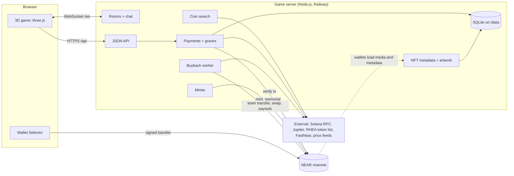

# Architecture

REST IN PUMP is one Node.js service that serves the game, runs the multiplayer world, verifies payments, mints Memorial NFTs and runs buyback rounds. The browser renders the 3D world and signs NEAR transactions through the player's wallet.

## Frontend and 3D world

- Vite build of TypeScript and three.js; Web Audio for music and sound.
- A seeded graveyard identical for every player: fence, mausoleum, trees, lanterns, fog, 40 plots in 5 rows of 8.
- Owls share one model and toon materials; 9 walk styles and 5 emotes are part of the synced player state.
- Graves are built from server data: the tombstone design follows the level, and recent offerings are piled in front.
- Nameless NPC owls (only on each player's screen) keep the world from feeling empty. `?demo` shows 40 of them for screenshots; they never count as players.
- The wallet code (NEAR Wallet Selector with MyNearWallet, Meteor and HERE) is loaded only when a player needs it.
- `?film` plays the trailer scene for video production (`client/src/film/`); it sends nothing to the chain.

## WebSocket multiplayer

- The server is the source of truth for who is online, names and accepted positions.
- Clients send their state 15 times a second, only when it changes. The server clamps every update (inside the world, at most run speed, sane hop height, valid walk and emote).
- The server broadcasts compact snapshots 15 times a second; clients draw other players slightly in the past and interpolate.
- One shared graveyard (`MAX_ROOMS=1`, `ROOM_CAPACITY=50`). A dropped player keeps their slot for 20 seconds; a refresh resumes the same player.
- Grave creations, offerings and level changes are pushed to everyone as `grave_added`, `grave_updated` and `plots_reserved` messages.
- Protocol and validation live in `shared/protocol.ts`, used by both sides.

## Server responsibilities

| Module | Responsibility |
|---|---|
| `server.ts` | HTTP (static files, `/healthz`, `/api`, `/nft`), WebSocket, timers, security headers |
| `rooms.ts`, `names.ts` | Rooms, players, random names |
| `api.ts` | JSON API, rate limits, browser session header |
| `graves.ts` | Orders, holds, payment confirmation, expiry, EXP, levels, memorial queue |
| `near.ts` | NEAR RPC with fallbacks: token metadata, transaction verification, balances |
| `solana.ts` | Solana mint lookup, safe logo download and conversion |
| `search.ts` | Coin search for the grave dialog |
| `price.ts` | Live NEAR/USD |
| `minter.ts` | Memorial NFT minting |
| `nft.ts` | Live NFT metadata and SVG artwork |
| `buyback.ts` | Buyback rounds |
| `db.ts` | SQLite and migrations |

### Background jobs

| Every | Job |
|---|---|
| 1/15 s | Room snapshots |
| 15 s | Payment sweep: expire holds, re-check interrupted verifications |
| 20 s | Minter: mint queued memorials |
| 10 min | Buyback check |
| 6 h | Refresh the RHEA token list used by search (on demand) |

## Database and persistence

SQLite through Node's built-in `node:sqlite`, on a Railway volume (`DB_PATH=/data/rip.sqlite`). Migrations run at start.

| Table | Holds |
|---|---|
| `payments` | Every grave and offering order: status, exact amount, plot, memecoin, message, transaction hash (unique), payer, browser session |
| `graves` | One row per grave: plot (unique), chain and contract (unique), name, symbol, logo, message, creator, EXP, offering count |
| `offerings` | Each offering: grave, item, EXP, payer, payment (unique) |
| `memorials` | One per wallet per grave: serial, mint status, attempts, token id |
| `buyback_rounds`, `buyback_payouts` | Each round's steps and each holder payout |

Graves, offerings, memorials, payments and buyback records survive restarts. Player sessions are in memory only.

## Memecoin lookup

- **NEAR:** the server calls `ft_metadata` on the token contract for name, symbol, decimals and logo.
- **Solana:** Solana RPC `getAccountInfo` confirms an SPL or Token-2022 mint and its decimals; name, ticker and logo come from Jupiter's token search, with Token-2022 on-chain metadata as a fallback.
- **Search by name or ticker:** NEAR searches RHEA's full token list (about 8,000 tokens, inactive ones included); Solana uses Jupiter's search. Memorials that already exist are listed first with their plot.
- **Logos:** downloaded once by the server, checked, and converted to small WebP data URIs, so browsers never load images from token creators' hosts.

## Payment processing

1. `POST /api/payments` (grave) or `POST /api/offerings` creates an order with a unique exact NEAR amount; a grave order holds its plot and memecoin.
2. The browser's wallet sends a plain NEAR transfer to the treasury and the browser saves the transaction hash.
3. `POST /api/payments/:id/confirm` verifies the transaction on NEAR and fulfils the order in one database transaction.
4. The sweep finishes interrupted confirmations and expires unpaid holds.

Rules and checks: [ECONOMY.md](ECONOMY.md#3-paying).

## NFT metadata generation

- The contract stores relative paths (`grave/<id>/media.svg`, `token/<id>.json`) under its `base_uri` (`https://rip.whatthehoot.lol/nft`).
- `GET /nft/token/<id>.json` returns the current name, description, image and attributes (memecoin, contract, chain, grave id, level, community EXP, offerings, original wallet, personal offerings, dates).
- `GET /nft/grave/<id>/media.svg` renders the grave's current level art with the memecoin's logo, ticker and EXP.
- Because every memorial of a grave points at the same grave art, they all evolve together.

## NFT minting queue

- Fulfilling a grave queues #001 for the creator; a wallet's first offering to a grave queues its memorial (one per wallet per grave, unique in the database).
- Every 20 seconds the minter claims pending memorials, checks `memorial_of` on the contract (so a retry never double-mints), and calls `mint_memorial` with the mint-only key.
- Failures back off from 30 seconds to 30 minutes; after 10 attempts the memorial is marked `failed` and logged for the operator.

## Buyback worker

Runs every 10 minutes when `BUYBACK_ACCOUNT_ID` and `BUYBACK_PRIVATE_KEY` are set. Each round goes `team` -> `swap` -> `distribute`, recording each step before sending it and stopping as `needs_check` on any unknown outcome. Details: [ECONOMY.md](ECONOMY.md#5-buyback-rounds).

## Deployment

- Railway, one service: build `npm run build`, start `npm start`, Node 24 (`RAILPACK_NODE_VERSION=24`).
- A volume mounted at `/data` for SQLite.
- Custom domain `rip.whatthehoot.lol` with HTTPS and WSS; `TRUST_PROXY=1`; `ALLOWED_ORIGINS=https://rip.whatthehoot.lol`.
- Secrets (`MINTER_PRIVATE_KEY`, `BUYBACK_PRIVATE_KEY`) only in Railway variables.

## External dependencies and failure behavior

| Dependency | Used for | If it fails |
|---|---|---|
| NEAR RPC (fastnear, near.org, with fallbacks) | Verification, metadata, minting, buybacks | Confirmations stay pending and are retried; minting and buybacks retry later |
| NEAR/USD feeds (CoinGecko, Coinbase, Kraken, Binance) | Pricing | After 15 minutes without an answer, new orders pause |
| Solana RPC, Jupiter | Solana memorials, search | Solana lookups fail with a clear message; NEAR is unaffected |
| RHEA token list | NEAR search | Search returns the last loaded list, or nothing; pasting an address still works |
| RHEA DCL | Buyback swap | The step fails and is retried, or the round stops |
| FastNear holder API | Buyback holder list | The round waits or stops as `needs_check` |
| The game server itself | NFT media and metadata | Wallets cannot load NFT art; ownership on chain is unaffected |
